# 🇧🇷 gov-skills: Inteligência de Dados Públicos do Governo Federal

> **O repositório definitivo de skills para agentes de IA dominarem, baixarem, persistirem, relacionarem e cruzarem TODOS os dados públicos abertos do Brasil.**

---

## 🧭 Visão do Projeto

O Brasil possui uma das legislações de transparência mais avançadas do mundo (Lei de Acesso à Informação - LAI nº 12.527/2011), resultando em dezenas de bilhões de registros públicos abertos. Contudo, esses dados estão **dispersos em dezenas de portais, APIs REST, endpoints OData, dumps diários em Parquet/CSV e bases relacionais heterogêneas**.

O **`gov-skills`** resolve esse desafio transformando esse oceano fragmentado em um **Data Lakehouse local e unificado (baseado em DuckDB)** alimentado por **skills modulares prontas para agentes de IA** (Antigravity, Claude Code, Cursor, OpenCode, AutoGen, CrewAI).

---

## 🏛️ Matriz Geral de Skills (16 Domínios Governamentais)

| Skill | Órgão / Fonte | Tipo de Acesso | O que a Skill Domina |
| :--- | :--- | :--- | :--- |
| [`gov-compras-pncp`](skills/gov-compras-pncp/SKILL.md) | PNCP / Compras.gov | REST API Pública | Licitações, contratos, atas e editais sob a Nova Lei de Licitações (Lei 14.133/21). |
| [`gov-receita-cnpj`](skills/gov-receita-cnpj/SKILL.md) | Receita Federal (RFB) | API Aberta & Dumps | +50M de empresas: Razão social, quadro de sócios (QSA), capital social, Simples e MEI. |
| [`gov-transparencia-cgu`](skills/gov-transparencia-cgu/SKILL.md) | CGU / Transparência | REST API & CSVs | Sanções (CEIS, CNEP, CEPIM), folha SIAPE, viagens (SCDP) e cartões corporativos CPGF. |
| [`gov-legislativo-camara`](skills/gov-legislativo-camara/SKILL.md) | Câmara dos Deputados | REST API v2 & Lote | 513 deputados, proposições/PLs, votações nominais e despesas da cota parlamentar (CEAP). |
| [`gov-legislativo-senado`](skills/gov-legislativo-senado/SKILL.md) | Senado Federal | REST API | 81 senadores, matérias legislativas, votações em plenário e verba CEAPS. |
| [`gov-economia-bcb`](skills/gov-economia-bcb/SKILL.md) | Banco Central (BACEN) | OData & SGS REST | Selic diária, IPCA, Dólar PTAX, projeções de mercado do Relatório Focus e dados do Pix. |
| [`gov-estatistica-ibge`](skills/gov-estatistica-ibge/SKILL.md) | IBGE | REST APIs | Malha de 5.570 municípios, hierarquia territorial, Censo Demográfico e PIB Municipal. |
| [`gov-eleitoral-tse`](skills/gov-eleitoral-tse/SKILL.md) | TSE | Dados Abertos | Candidaturas, bens declarados de políticos, doações de campanha e resultados eleitorais. |
| [`gov-tesouro-siconfi`](skills/gov-tesouro-siconfi/SKILL.md) | Tesouro Nacional | REST API | Siconfi, repasses de transferências (FPM, FPE, Fundeb), balanços fiscais RREO/RGF e LOA. |
| [`gov-saude-datasus`](skills/gov-saude-datasus/SKILL.md) | Ministério da Saúde | OpenDataSUS / FTP | Estabelecimentos de saúde (CNES), leitos hospitalares, leitos UTI e procedimentos SUS. |
| [`gov-educacao-inep`](skills/gov-educacao-inep/SKILL.md) | INEP / MEC | Microdados & APIs | Censo Escolar (180k escolas), notas e indicadores do IDEB e dados do ENEM. |
| [`gov-trabalho-mte`](skills/gov-trabalho-mte/SKILL.md) | Ministério do Trabalho | Microdados / FTP | Novo CAGED (saldo mensal de contratações/demissões CLT por município e setor CNAE). |
| [`gov-ambiente-inpe-ibama`](skills/gov-ambiente-inpe-ibama/SKILL.md) | INPE & IBAMA | APIs & GeoJSON | Desmatamento (DETER/PRODES), focos de queimadas, autos de infração e embargos ambientais. |
| [`gov-diario-oficial-dou`](skills/gov-diario-oficial-dou/SKILL.md) | Imprensa Nacional | InCom / DOU | Atos normativos (Seção 1), nomeações/pessoal (Seção 2) e contratos/editais (Seção 3). |
| [`gov-dados-catalogo`](skills/gov-dados-catalogo/SKILL.md) | dados.gov.br | CKAN REST API | Metadados e descoberta de novos conjuntos de dados abertos do Governo Digital. |
| [`gov-divida-pgfn`](skills/gov-divida-pgfn/SKILL.md) | PGFN / Fazenda | Dados Abertos | Lista de devedores inscritos em Dívida Ativa da União e débitos de FGTS. |
| [`gov-municipios-querido-diario`](skills/gov-municipios-querido-diario/SKILL.md) | Querido Diário / OKBR | REST API Pública | Busca textual completa em Diários Oficiais Municipais (DOMs) de todo o Brasil. |
| [`gov-controle-tcu`](skills/gov-controle-tcu/SKILL.md) | TCU | Dados Abertos | Contas julgadas irregulares (Ficha Limpa) e empresas declaradas inidôneas pelo TCU. |
| [`gov-saude-cmed`](skills/gov-saude-cmed/SKILL.md) | CMED / Anvisa | Dados Abertos | Teto de preços de remédios, Preço Fabricante (PF) e desconto obrigatório do CAP. |
| [`gov-fiscal-pacto-federativo`](skills/gov-fiscal-pacto-federativo/SKILL.md) | RFB & STN | SQL Lakehouse | Balanço Fiscal Federativo: Estados que mais recebem auxílios vs o que arrecadam. |
| [`gov-cruzamentos-auditoria`](skills/gov-cruzamentos-auditoria/SKILL.md) | Multi-órgãos | SQL Lakehouse | **Meta-skill**: Dossiê 360º de CNPJs, teia societária e detecção de anomalias/red flags. |

---

## 🔑 As 4 Chaves Universais de Relacionamento

Todas as tabelas do ecossistema são normalizadas para permitir **junções automáticas (SQL Joins)** através de 4 chaves mestras do Estado brasileiro:

```mermaid
graph TD
    A["CNPJ / CNPJ Raiz (8 dígitos)"] --> B["Receita Federal (Empresas & Sócios QSA)"]
    A --> C["PNCP (Licitações & Contratos)"]
    A --> D["CGU (Sanções CEIS / CNEP)"]
    A --> E["Câmara (Cota Parlamentar CEAP)"]
    A --> F["TSE (Doações Eleitorais)"]

    G["Código IBGE (7 dígitos)"] --> H["IBGE (Malha de 5.570 Municípios)"]
    G --> I["Siconfi (Repasses FPM / Fundeb)"]
    G --> J["DataSUS (Hospitais & Leitos)"]
    G --> K["INEP (Censo Escolar & IDEB)"]
    G --> L["Novo CAGED (Emprego Formal)"]

    M["CPF Mascarado / Nome"] --> B
    M --> N["CGU (Servidores SIAPE)"]
    M --> O["TSE (Candidatos & Doadores)"]
    M --> P["Câmara & Senado (Parlamentares)"]

    Q["Código SIAFI / UG"] --> R["Tesouro (Execução Orçamentária LOA)"]
    Q --> S["Compras Públicas (Órgão Demandante)"]
```



---

## ⚡ Instalação & Setup Rápido

O projeto utiliza o gerenciador ultrarrápido **[`uv`](https://github.com/astral-sh/uv)**:

```bash
# 1. Clone o repositório
git clone https://github.com/brunoqualhato/gov-skills.git
cd gov-skills

# 2. Instale dependências e ambiente virtual
uv sync

# 3. Verifique o status do Lakehouse e o catálogo de skills
uv run gov-skills info
uv run gov-skills skills
```

---

## 🛠️ Exemplos Operacionais

### 1. Ingerir Dados Reais do Governo
```bash
# Ingerir malha completa de municípios do IBGE (5.571 municípios)
uv run python skills/gov-estatistica-ibge/scripts/fetch_ibge.py

# Ingerir deputados federais e despesas completas da CEAP (230k+ notas)
uv run python skills/gov-legislativo-camara/scripts/fetch_camara.py deputados
uv run python skills/gov-legislativo-camara/scripts/fetch_camara.py despesas-lote --ano 2024

# Ingerir contratos recentes do PNCP (Lei 14.133/21)
uv run python skills/gov-compras-pncp/scripts/fetch_pncp.py --dias 7

# Ingerir séries macroeconômicas do Banco Central (Selic, Focus)
uv run python skills/gov-economia-bcb/scripts/fetch_bcb.py series --codigo 432 --anos 1
uv run python skills/gov-economia-bcb/scripts/fetch_bcb.py focus --top 50

# Enriquecer fornecedores com dados da Receita Federal (QSA sócios)
uv run python skills/gov-receita-cnpj/scripts/fetch_cnpj.py enriquecer-fornecedores --limit 10
```

### 2. Gerar Dossiê Investigativo 360º de uma Empresa
Cruza instantaneamente **Receita Federal + Sócios (QSA) + Contratos do PNCP + Gastos da Cota Parlamentar + Sanções da CGU**:

```bash
uv run python skills/gov-cruzamentos-auditoria/scripts/dossie_empresa.py --cnpj 31003259000110
```

### 3. Executar o Detector de Anomalias e Auditorias Forenses
O ecossistema possui algoritmos forenses para varrer o banco em busca de red flags:

```bash
# 1. Auditoria de Preços e Sobrepreço (ex: mouse a mil reais, café a R$ 90)
uv run gov-skills auditoria-precos --fator 2.0

# 2. Conluio & Cartel: Empresas distintas com mesmo telefone, e-mail ou endereço na Receita
uv run gov-skills auditoria-cartel

# 3. Sócios Laranjas: Beneficiários do Bolsa Família/BPC donos de empresas licitantes
uv run gov-skills auditoria-laranjas

# 4. Conflito de Interesses: Servidores federais da ativa (SIAPE) administrando empresas
uv run gov-skills auditoria-servidores

# 5. O Ciclo das Emendas Pix: Deputado envia verba -> Município contrata fornecedor correlato
uv run gov-skills auditoria-emendas-pix

# 6. Devedores da Dívida Ativa da União (PGFN) recebendo dinheiro público no PNCP
uv run gov-skills auditoria-pgfn

# 7. Balanço Fiscal Federativo: Ranking de dependência de auxílios e transferências por estado
uv run gov-skills balanco-federativo

# 8. A Empresa Sem Funcionários: Contratos milionários com 0 funcionários no CAGED/RAIS
uv run gov-skills auditoria-capacidade

# 9. Cronologia Suspeita: Empresas recém-criadas vencendo licitações de alto valor
uv run gov-skills auditoria-cronologia

# 10. Medicamentos Superfaturados no SUS: Compras acima do teto regulatório da CMED/Anvisa
uv run gov-skills auditoria-medicamentos

# 11. O Triângulo Eleitoral: Doador de Campanha (TSE) -> Cota Parlamentar (CEAP) -> Licitações
uv run gov-skills auditoria-triangulo

# 12. Nepotismo Oculto: Parentesco entre agentes públicos locais e empresas vencedoras
uv run gov-skills auditoria-nepotismo

# 13. Varredura geral de inconsistências cadastrais e de faturamento (Simples Nacional)
uv run gov-skills auditoria-anomalias
```

---

## 🤖 Uso com Agentes de IA

Cada pasta em `skills/<nome-da-skill>/` contém um arquivo **`SKILL.md`** padronizado com metadados YAML, descrição de schemas, instruções de execução e exemplos prontos de prompts e queries. Qualquer agente pode ler o `SKILL.md` correspondente e executar as ações necessárias de forma autônoma.

---

## 📄 Licença
Distribuído sob a licença **MIT**. Todos os dados consumidos são de natureza estritamente pública em conformidade com a **Lei de Acesso à Informação (Lei Federal nº 12.527/2011)** e a **Lei Geral de Proteção de Dados (Art. 7º, § 3º e Art. 23 da LGPD)**.
